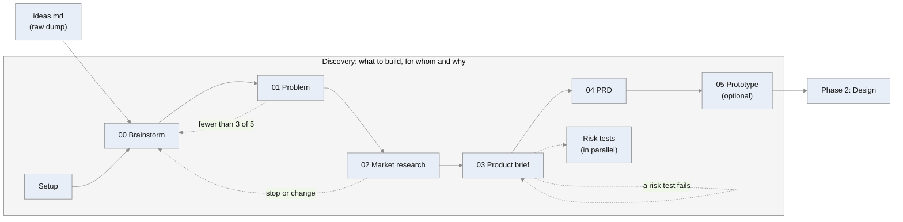
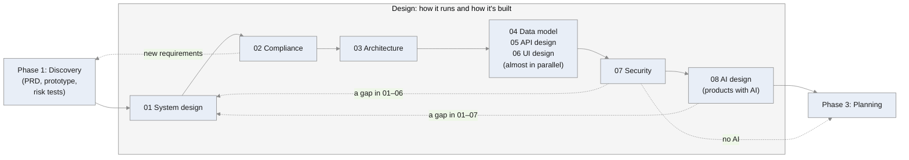

# Flows

Recipes: which skills to run, in what order, and what each one reads and writes, for one situation. The same skill can appear in several recipes. A new recipe is added when its skills exist.

## Recipe: a new SaaS product

From an idea, or no idea, to a product that people pay for, in five phases:

| Phase | What it does | Skills |
|---|---|---|
| **1. Discovery** | from zero to what to build: the problem, the market, the decision, the MVP | below |
| **2. Design** | how the system runs, how the code is organized, the data, the API, the screens, the law, security and AI | below: 01–08 written |
| **3. Planning** | split the work into slices and tasks, estimate from the design, set the order | not written yet |
| **4. Build** | implement, test and deploy, every slice (deploy from the first week) | not written yet |
| **5. Launch & Growth** | launch, then grow and measure | not written yet |

Design comes before Planning: you can't estimate what you haven't designed. Testing and deploying aren't the end of Build, they happen on every slice.

### Phase 1: Discovery



#### Start
1. Run `/docs-setup` once: it decides where the documents live and writes the `Project documents:` line in `CLAUDE.md`.
2. Write everything in your head into `docs/00-project/ideas.md`, in any form. No idea yet? Leave it empty.
3. Run `/brainstorm`.

#### The steps

| # | Step | Command | Reads | Writes | Ends with |
|---|---|---|---|---|---|
| – | [Setup](skills/docs-setup/SKILL.md) | `/docs-setup` | the user's answers | `CLAUDE.md` line, `ideas.md` (empty), `01-discovery/` | the documents' place exists and the skills know it |
| 00 | [Brainstorm](skills/brainstorm/SKILL.md) | `/brainstorm` | `ideas.md` (raw) | `00-brainstorm.md`, `ideas.md` (shaped) | one problem picked, two fallbacks |
| 01 | [Problem](skills/problem/SKILL.md) | `/problem` | `00-brainstorm.md`, `ideas.md` | `01-problem.md` | 3 of 5 interviews confirm it, or "not yet verified" |
| 02 | [Market research](skills/market-research/SKILL.md) | `/market-research` | `01-problem.md` | `02-market-research.md` | go, change or stop |
| 03 | [Product brief](skills/product-brief/SKILL.md) | `/product-brief` | `01`, `02`, `ideas.md` | `03-product-brief.md` | go, go with conditions, change or stop |
| 04 | [PRD](skills/prd/SKILL.md) | `/prd` | everything above | `04-prd.md`, `ideas.md` (sorted) | ready for delivery |
| 05 | [Prototype](skills/prototype/SKILL.md) (optional) | `/prototype` | `04-prd.md`, `03-product-brief.md` | `05-prototype.md`, brief and PRD updated | pass, or fix and retest |
| – | [Risk tests](skills/risk-tests/SKILL.md) (in parallel, from 03) | `/risk-tests` | `03-product-brief.md` | `risk-tests/` (an overview, one folder per test), brief updated | every risk in the brief has a result |

All files are in `docs/01-discovery/`, except `docs/00-project/ideas.md`. `docs/` is the documents folder from the `Project documents:` line in `CLAUDE.md`.

### Phase 2: Design



#### Start
1. The PRD is done, and the prototype if you made one. The risk tests may still be running; their results come into the step that needs them (an AI test into 08).
2. Run `/system-design`. It creates `docs/02-design/README.md`, the map with each step's status.
3. Then the steps in order. A product without AI goes from 07 to Planning.

#### The steps

| # | Step | Command | The question it answers |
|---|---|---|---|
| 01 | [System design](skills/system-design/SKILL.md) | `/system-design` | how does the system run? components, data flows, scale, failures, monitoring, cost, deployment and CI/CD |
| 02 | [Compliance](skills/compliance/SKILL.md) | `/compliance` | what does the law require? data location, providers and their agreements, retention, consents, licences |
| 03 | [Architecture](skills/architecture/SKILL.md) | `/architecture` | how is the code organized? modules, inside a module, the requirements in code, languages and tools, conventions, testing strategy |
| 04 | [Data model](skills/data-model/SKILL.md) | `/data-model` | what data, how it relates, which rules? entities, the questions and volumes, tables with why, indexes checked on generated data, lifecycle, offline data, migrations, test data |
| 05 | [API design](skills/api-design/SKILL.md) | `/api-design` | how do the app and the server talk? the clients and style, every endpoint with its shapes and why, errors, lists, repeats and concurrency, sync, webhooks and files, changes that don't break old clients, a contract checked by a linter |
| 06 | [UI design](skills/ui-design/SKILL.md) | `/ui-design` | what do people see and do? the map of screens and the navigation, the flows with their failure paths, every screen's states, the words, a small design system checked for contrast, accessibility; the key screens now, the others one slice ahead of their code |
| 07 | [Security](skills/security/SKILL.md) | `/security` | what can be attacked and how is it protected? the assets and the attackers, a bar from OWASP ASVS, the map with its trust boundaries, every flow's threats (STRIDE) with their protections and checks, the numbers for passwords, sessions and limits, the headers, secrets, the supply chain, the accounts, detection; the whole model now, each slice's new ways in before its code |
| 08 | [AI design](skills/ai-design/SKILL.md) | `/ai-design` | for products with AI: what's inside the AI box? every AI job's card, the measure and threshold with its margin, the pinned model, the prompt and the answer's schema, evals as a process, the attacks specific to AI, what the person sees, tokens and cost measured, production signals, the AI Act; contracts and the riskiest job now, the other prompts one slice ahead of their code |

What each step reads and writes:

| # | Reads | Writes | Ends with |
|---|---|---|---|
| 01 | PRD, brief, risk tests; the running system, if one exists | `01-system-design/`, the map `02-design/README.md` | the requirements with numbers, the shape and the monthly cost, confirmed by the user |
| 02 | 01, PRD, brief; the running app's tables | `02-compliance/`, the new requirements in the PRD | every kind of data with its purpose, legal basis, place and retention; the consents and the minimum age decided |
| 03 | PRD, 01, 02; existing code | `03-architecture/` | every requirement has a module, a mechanism and an automatic check |
| 04 | PRD, 01–03; an existing database | `04-data-model/`, `schema.sql` | `schema.sql` runs on a real database |
| 05 | PRD, 01–04; an existing API | `05-api-design/`, `openapi.yaml` | `openapi.yaml` holds every endpoint and passes the linter |
| 06 | PRD, prototype, 01–05; an existing app | `06-ui-design/`: wireframes, mockups, tokens | the key screens' mockups pass the page check; the test with people decided |
| 07 | everything, and what 01–06 left for Security | `07-security/`, the scripts that try the decisions | every threat with its protection and its check, or an accepted risk with its owner |
| 08 | everything, and what 01–07 left for AI design; the AI risk test | `08-ai-design/`: the prompts, the evals | every AI job with a threshold, a pinned model and its prompt; what blocks a release decided |

Every step writes its hard-to-undo choices as ADRs, in `docs/00-project/adr/`, and sets its own row in the map when it ends. When a step finds a gap in an earlier one, it stops, says so, and on a yes fixes it where it lives, with a line in that document's journal.

UI design runs again in Build, once per slice, before the slice's code: `/ui-design slice <n>` designs that slice's screens in full, one slice ahead. Security does too: `/security slice <n>` passes over what the slice brings in and puts its protections in the slice's definition of done; and `/security validate` runs again before the first tester and before launch. AI design does too: `/ai-design slice <n>` writes the slice's prompts and test sets before its code; and the evals run again at every prompt or model change.

Compliance comes right after System design: it needs the list of providers, and it changes the data model (consent records, retention), the API (export, deletion) and the screens (consent, minimum age). It runs again before launch, to check everything exists and works. 04–06 can run almost in parallel; 07–08 check what 01–06 decided.

At work you'll hear "high-level design" (HLD) and "low-level design" (LLD); every company draws the line differently, so they aren't step names here. The translation: HLD is 01 System design plus the modules in 03 Architecture; LLD is the rest of 03, 04 Data model and 05 API design; 02, 06, 07 and 08 touch both. `docs/02-design/README.md` holds this map for the project, with each step's status.

## Where the documents go

`docs/` is wherever `/docs-setup` put it: a private docs repo, `docs/` in the code repo, or the team's existing place. The `Project documents:` line in `CLAUDE.md` points to it. Inside, one folder per phase, numbered in the order of the road; each step is numbered inside it, as a file, or as a folder when it has several files (a README is its entry). What belongs to the whole project, not to one phase, sits in `00-project/`: the ideas and the decisions (ADRs), which come from every phase:

```
docs/
  00-project/
    ideas.md             your raw ideas, shaped in 00 Brainstorm, sorted in 04 PRD
    adr/                 the decisions that are hard to undo, from every phase
      0001-database.md …
  01-discovery/
    00-brainstorm.md
    01-problem.md
    02-market-research.md
    03-product-brief.md
    04-prd.md
    05-prototype.md
    risk-tests/
      README.md          every risk: pass mark, when, status
      ai-plate-scan/     one folder per test: README, scripts, raw data
  02-design/
    README.md            the map: each step, its question, high-level or low-level design, status
    01-system-design/
      README.md          status, summary, what we skip, open questions, ADRs, glossary, journal
      01-requirements.md … 12-cost.md
      diagrams/
    02-compliance …
```

## Extra clarifications

### Risk tests
**What it is:** a small experiment that checks one risky assumption before you spend months building on it. The brief lists the risks, each with a test and a pass mark; this step runs them one by one.

**An example, the AI plate scan:**
- **The assumption:** "the AI recognizes what's on the plate and roughly how much". The scan feature rests on it.
- **The experiment, 1–2 days of work spread over a week:** before eating, weigh each food on the plate and take a photo, until you have 20 plates. Work out the real calories from the weights. Send the 20 photos to the AI provider you're considering and note its estimates.
- **The pass mark, fixed before you start:** 15 of 20 plates within ±20% of the real calories.
- **The decision:** pass → pick that provider and build the scan. Fail → try another provider, change the feature (the AI names the foods, you enter the grams), or postpone it.

**What it gives you:** you learn in days what you'd otherwise learn after months of code, and every decision rests on numbers, not hope.

**When to run one:** when you're about to build or decide something that rests on an assumption you haven't checked, and being wrong would cost a lot.

You recognize it when you hear yourself say "I think people will…", "the AI can probably…", "it should work…". Then ask two questions: if it's false, how much do I lose? How much does checking it first cost?

| Loss if it's false | Cost of checking | What to do |
|---|---|---|
| big | small | **run the test** |
| small (a two-way door) | any | just do it and watch |
| big | big | find a smaller test, or cut the risk (postpone the feature) |

Examples: "the AI can estimate calories from a photo" (weeks of code if false, a week of photos to check) → test now. "Developers want to lose weight with my app" (the whole project if false, 5 conversations to check) → test as early as possible. "The blue button is better" → just do it.

The brief's "When" column is this rule already applied to the risks you know at the start. Run them with `/risk-tests`.

### Validate
**What it is:** every step from 01 on can also judge a document that already exists, without changing it: `/<skill> validate <file>`, for example `/prd validate docs/01-discovery/04-prd.md`. It's a code review for a document:
1. it reads the document and the ones it comes from (a PRD with its brief and problem);
2. it checks it item by item against what the step asks for, citing the lines;
3. it asks the questions no template asks (does every MVP feature trace back to the problem? do the numbers agree?);
4. it reports the problems from the most serious down, each with the line and what to change, then what the document does well. You pick what to apply.

**What it gives you:**
- you find what's missing without rewriting the document;
- a second pair of eyes when nobody else can read it;
- it catches gaps that change decisions, not only formatting (for example "22 features don't fit the time until launch");
- you can rerun it after every big change.

**When to run it:**
- **on a document written without the skill:** an older version, someone else's, one from your job;
- **before a decision that's hard to undo:** the end of 03 (go or stop) and of 04 (before architecture and code);
- **after a big change:** a test failed, the MVP was cut;
- **when nobody else can read it.**

Not right after writing with the skill (its "Done when" already checked it), and not for small edits.
